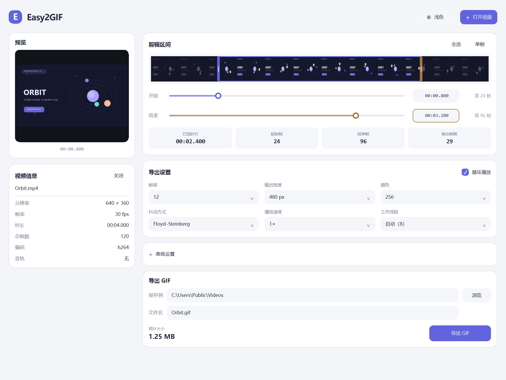
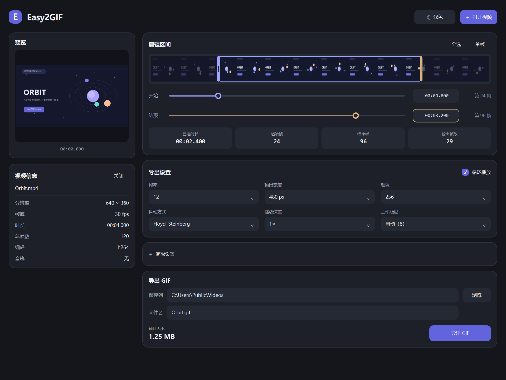
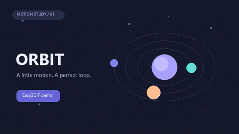

# Easy2GIF

把视频片段变成 GIF，让分享更简单。

Easy2GIF 是一款适用于 **Windows x64** 的视频转 GIF 工具。预览画面、选择片段、调整参数，即可导出动画。免安装，视频在本地处理，无需上传，也无需另行安装 FFmpeg。



## 功能

| 功能 | 说明 |
| --- | --- |
| 视频预览 | 查看画面、胶片条时间轴及分辨率、帧率、时长等信息 |
| 精确选区 | 拖动时间轴或输入时间、帧号，实时查看选区时长与输出帧数 |
| 导出设置 | 调整帧率、尺寸、颜色数、抖动、播放速度与循环播放 |
| 体积预估 | 根据当前选区与参数，自动估算 GIF 大小 |
| 高级调节 | 编码质量、有损压缩、抖动强度、重复帧合并与帧间透明优化 |
| 任务进度 | 导入时显示进度与百分比，导出时可查看进度并取消 |
| 主题切换 | 支持浅色、深色，首次启动默认浅色，并记住上次选择 |

## 开始使用

1. 将 Windows x64 版本的 ZIP 或 7z 压缩包**完整解压**到一个文件夹。
2. 运行 `easy2gif.exe`，点击右上角「打开视频」，或按 `Ctrl+O` 导入。
3. 通过时间轴或「开始」「结束」输入框选取要转换的片段。
4. 调整导出设置，选择保存文件夹与文件名，点击「导出 GIF」。

请保留程序目录中的 `bin`、`qml` 和 DLL 文件，它们是运行所需的组件。

### 选择片段

拖动胶片条上的选区边界，或调整「开始」「结束」滑块。「全选」可恢复整个视频的范围，「单帧」可选取一帧。

时间输入框支持以下写法：

| 输入 | 含义 |
| --- | --- |
| `00:01.500` | 1.5 秒 |
| `1:02` | 1 分 2 秒 |
| `83.5` | 83.5 秒 |
| `150f` | 第 150 帧 |

### 调整画质与大小

- **更小的文件**：缩短片段，降低输出宽度、帧率或颜色数。
- **更平滑的颜色过渡**：尝试 Floyd–Steinberg 抖动，并适当调整抖动强度。
- **更多控制**：展开「高级设置」，调整编码质量与压缩选项；可随时恢复默认值。

预计大小供导出前参考，最终体积以生成的文件为准。GIF 不包含音频。


### 深色模式

点击右上角的主题按钮即可切换，重新打开程序后会保留你的选择。



### 导出效果

下面的动画由 Easy2GIF 从示例视频实际导出。



## 从源码构建

项目采用 Rust 内核与 Qt Quick 界面。构建需要：

- Windows x64
- Qt 6.5 或更高版本，使用 MinGW 64 位套件
- Rust GNU 工具链：`stable-x86_64-pc-windows-gnu`
- CMake 3.21 或更高版本，以及 MinGW
- 完整的 FFmpeg / FFprobe 发行版

Rust 工具链默认从仓库内的 `.rustup_local` 读取。首次配置可执行：

```powershell
$env:RUSTUP_HOME = Join-Path $PWD '.rustup_local'
rustup toolchain install stable-x86_64-pc-windows-gnu
```

在 PowerShell 中构建：

```powershell
.\build.ps1
```

脚本的默认工具路径见 `build.ps1`，可通过参数指定本机安装位置：

```powershell
.\build.ps1 -QtRoot 'D:\Qt\6.10.2\mingw_64' `
            -MingwBin 'D:\Qt\Tools\mingw1310_64\bin' `
            -CMakeBin 'D:\Qt\Tools\CMake_64\bin' `
            -FfmpegExe 'C:\ffmpeg\bin\ffmpeg.exe' `
            -FfprobeExe 'C:\ffmpeg\bin\ffprobe.exe'
```

构建产物位于 `b\bundle`。生成发布压缩包：

```powershell
.\package.ps1 -SkipBuild              # 将已构建的程序打成 ZIP
.\package.ps1 -SharedMedia -SevenZip   # 构建并生成 ZIP、7z
```

压缩包与 SHA256 校验文件保存在 `b\releases`。`-SevenZip` 需要支持 7z 格式的 Windows `tar.exe`；省略该参数只生成 ZIP。

## 第三方组件

Easy2GIF 使用 [Qt](https://www.qt.io/) 和 [FFmpeg](https://ffmpeg.org/)。相关许可证与来源信息随发行包附带。
